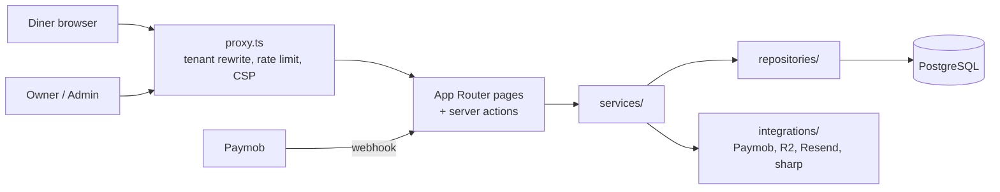

# Tabla — QR Menu SaaS

A multi-tenant SaaS that lets restaurants publish a bilingual (English/Arabic) digital menu behind a QR code and take dine-in or delivery orders through WhatsApp.

## Overview

Small and mid-sized restaurants often rely on printed menus or static PDFs that are hard to update and do not work well on phones. Tabla gives each restaurant its own mobile-first menu site, served from a subdomain or path, that the owner manages from a dashboard. Diners scan a QR code, browse the menu in their language, build a cart, and send the order to the restaurant on WhatsApp. The platform operator manages plans, themes, payments and support from a separate admin area.

Audience: restaurant and café owners (tenants), their diners, and the platform administrator.

## Features

**Diner storefront**
- Public menu per restaurant at `<slug>.<root-domain>` or `<root-domain>/<slug>` (tenant rewrite in `src/proxy.ts`)
- English and Arabic with full RTL support (`next-intl`)
- Pluggable themes: Classic, Garden, Modern, Street, Omakase, Elegant and Showcase layouts
- Item modals with option groups and price modifiers, cart, dine-in or delivery checkout
- Orders sent as a pre-filled WhatsApp message, with a shareable order summary page (`/o/[id]`)

**Restaurant owner dashboard**
- Onboarding wizard to create a restaurant
- Menu management: categories and items, drag-and-drop ordering (`@dnd-kit`), image upload, CSV template import
- Branding (hero, offers, colours) and theme selection with preview
- QR code generation and PDF export
- Orders list with daily, monthly and hourly analytics
- Billing: free trial, plan upgrades and paid themes via Paymob (card, Apple Pay) or manual InstaPay
- Support chat with the platform admin

**Platform admin**
- Manage restaurants, users, plans/packages, themes and payment methods
- Payments overview, audit log, analytics
- Support inbox and email broadcast to users (Resend)

**Security and platform**
- Credentials and Google sign-in (NextAuth v5) with bcrypt password hashing and password reset
- Environment validated at boot with Zod (`src/config/env.ts`)
- Nonce-based CSP, HSTS and other security headers on every request
- Rate limiting via Upstash Redis (global plus per-action limiters)
- Paymob webhook HMAC verification with idempotent payment handling
- Tenant isolation: owner mutations derive the restaurant from the session
- Image uploads re-encoded to WebP with `sharp` and stored in Cloudflare R2
- Optional Cloudflare Turnstile bot protection

## Tech stack

| Area | Technology |
|---|---|
| Framework | Next.js 16 (App Router), React 19, TypeScript (strict) |
| Styling | Tailwind CSS 4 |
| Data | PostgreSQL, Prisma 6 |
| Auth | NextAuth v5 (`@auth/prisma-adapter`), bcryptjs |
| Validation | Zod 4 |
| State | Zustand (cart) |
| i18n | next-intl |
| Payments | Paymob; InstaPay (manual, EmailJS notification) |
| Storage | Cloudflare R2 (S3 API via `@aws-sdk/client-s3`) |
| Email | Resend |
| Rate limiting | Upstash Redis |
| Logging | pino |

## Architecture

The codebase follows a layered structure: thin App Router pages and server actions call services, services hold business logic, and repositories are the only layer that talks to Prisma. External providers sit behind small adapter interfaces.



```
prisma/
  schema.prisma        Data model (users, restaurants, menu, orders, payments, plans, themes)
  seed.ts              Seeds themes and plans
src/
  app/                 Routes: (auth), (owner)/dashboard, (admin)/admin, t/[slug] storefront,
                       o/[id] order summary, api/ (auth, uploads, Paymob webhook), actions/
  components/          UI only, grouped by area (marketing, owner, admin, store, shared, ui)
  config/              Typed env, constants, plan helpers
  dtos/                Zod schemas and DTOs for every input boundary
  i18n/                next-intl config and en/ar message files
  integrations/        Adapters for payment, storage, messaging and image processing
  lib/                 Auth, security (headers, rate limiter, Turnstile), tenant, cache, errors, logger
  repositories/        Prisma data access
  services/            Business logic (menu, orders, payments, themes, admin, analytics)
  themes/              Theme registry and diner theme renderers
  proxy.ts             Edge proxy: tenant routing, rate limiting, security headers
docs/                  Production-readiness audit and agent notes
```

## Getting started

### Prerequisites
- Node.js 20+
- pnpm
- A PostgreSQL database
- An Upstash Redis database (rate limiting runs on every request)

### Setup

```bash
pnpm install
cp .env.example .env.local     # fill in values; the db:* scripts read .env.local
pnpm db:generate               # generate the Prisma client
pnpm db:push                   # apply the schema to the database
pnpm db:seed                   # seed themes and plans
pnpm dev                       # http://localhost:3000
```

### Other scripts

| Command | Purpose |
|---|---|
| `pnpm build` / `pnpm start` | Production build and server |
| `pnpm lint` | ESLint |
| `pnpm typecheck` | `tsc --noEmit` |
| `pnpm db:migrate` | `prisma migrate dev` |
| `pnpm db:studio` | Prisma Studio |

## Environment variables

See `.env.example` for placeholders. Server variables are validated in `src/config/env.ts`.

| Variable | Required | Purpose |
|---|---|---|
| `DATABASE_URL` | Yes | PostgreSQL connection string |
| `DIRECT_URL` | No | Direct (non-pooled) connection |
| `NEXTAUTH_SECRET` | Yes | Session signing secret (32+ chars) |
| `NEXTAUTH_URL` | Yes | Base URL for auth callbacks |
| `GOOGLE_CLIENT_ID`, `GOOGLE_CLIENT_SECRET` | No | Google sign-in |
| `APP_ROOT_DOMAIN` | Yes | Root domain used for tenant routing |
| `APP_PUBLIC_URL` | Yes | Public URL for menu links, QR codes, emails |
| `UPSTASH_REDIS_REST_URL`, `UPSTASH_REDIS_REST_TOKEN` | Yes | Rate limiting |
| `NEXT_PUBLIC_SUPABASE_URL`, `NEXT_PUBLIC_SUPABASE_PUBLISHABLE_KEY` | Yes | Supabase project (validated at boot) |
| `SUPABASE_SERVICE_ROLE_KEY` | No | Supabase server key |
| `NEXT_PUBLIC_TURNSTILE_SITE_KEY`, `TURNSTILE_SECRET_KEY` | No | Cloudflare Turnstile |
| `R2_ACCOUNT_ID`, `R2_ACCESS_KEY_ID`, `R2_SECRET_ACCESS_KEY`, `R2_BUCKET`, `R2_PUBLIC_URL` | No | Image storage |
| `PAYMOB_API_KEY`, `PAYMOB_HMAC_SECRET`, `PAYMOB_INTEGRATION_ID`, `PAYMOB_APPLE_PAY_INTEGRATION_ID`, `PAYMOB_IFRAME_ID` | No | Online payments |
| `EMAIL_FROM`, `RESEND_API_KEY` | No | Transactional and broadcast email |
| `NEXT_PUBLIC_INSTAPAY_PHONE` | No | InstaPay number shown to owners |
| `NEXT_PUBLIC_EMAILJS_SERVICE_ID`, `NEXT_PUBLIC_EMAILJS_TEMPLATE_ID`, `NEXT_PUBLIC_EMAILJS_PUBLIC_KEY` | No | InstaPay request notification |
| `NODE_ENV`, `LOG_LEVEL` | No | Runtime mode and pino log level (default `info`) |

## Notes and limitations

- No automated tests yet; there is no test runner or `test` script.
- The schema is applied with `prisma db push`; there is no migration history yet.
- Payments, storage, email and Turnstile are optional at boot, so a misconfigured deployment can start without them.
- The Supabase client helpers in `src/lib/supabase/` are not imported by the app; data access goes through Prisma.
- The InstaPay notification is sent from the browser via EmailJS.
- A production-readiness audit with the open punch-list is in [`docs/production-readiness.md`](docs/production-readiness.md).
